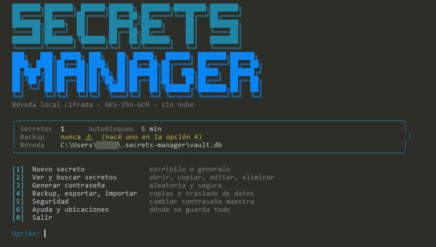
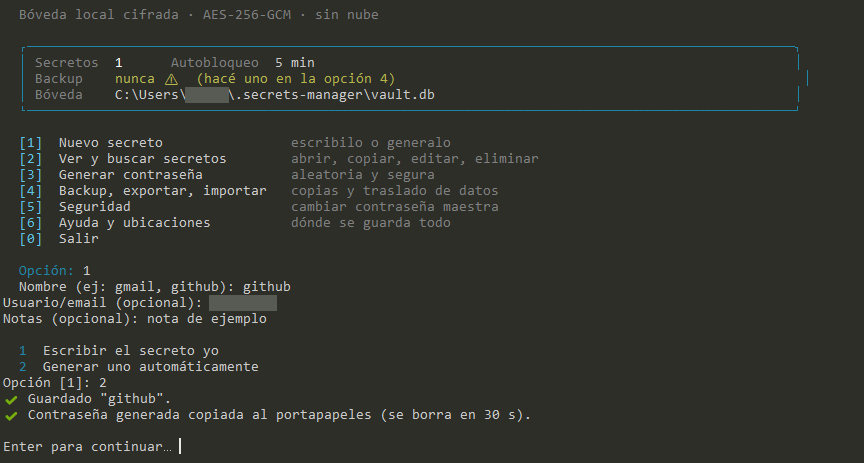
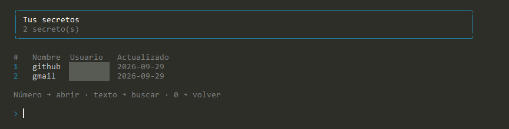
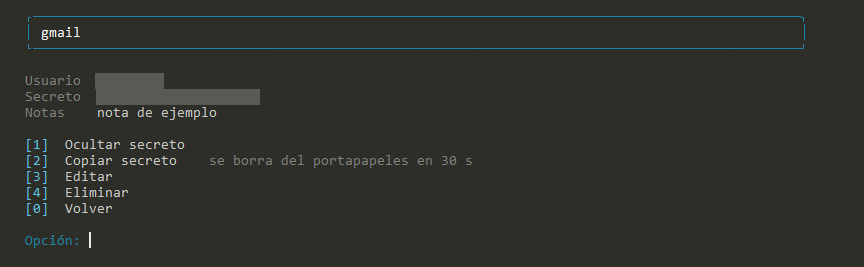
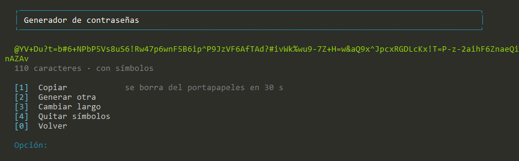
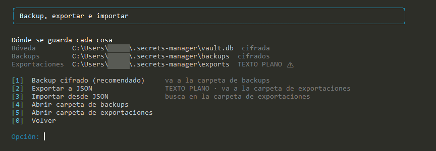
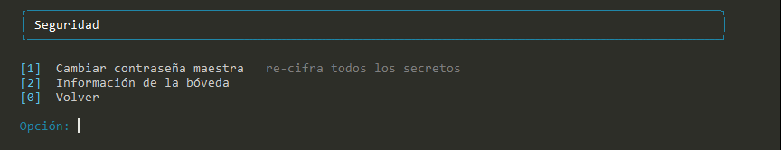
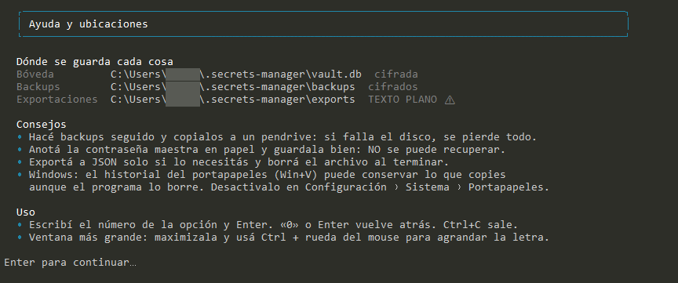

# Secrets Manager (`sm`)

Gestor de contraseñas **local y personal**, por línea de comandos, con menú interactivo. Guarda tus credenciales cifradas en un archivo SQLite en tu propia computadora: **sin nube, sin cuentas, sin sincronización** (a propósito).



> Las capturas de este documento usan datos de ejemplo; el usuario de Windows y los datos personales fueron tapados.

## Índice

1. [Características](#características)
2. [Requisitos](#requisitos)
3. [Instalación](#instalación)
4. [Primer uso](#primer-uso)
5. [Recorrido por el menú](#recorrido-por-el-menú)
6. [Comandos directos](#comandos-directos)
7. [Dónde se guarda cada cosa](#dónde-se-guarda-cada-cosa)
8. [Backup y restauración](#backup-y-restauración)
9. [Cómo funciona la seguridad (y sus límites)](#cómo-funciona-la-seguridad-y-sus-límites)
10. [Solución de problemas](#solución-de-problemas)
11. [Desarrollo](#desarrollo)

---

## Características

- **Cifrado fuerte:** AES-256-GCM, con la clave derivada de tu contraseña maestra mediante scrypt. Nada se guarda en texto plano.
- **Menú numerado** (1, 2, 3…) y también **comandos directos** para usar en scripts.
- **Generador de contraseñas** aleatorias (criptográficamente seguras) y guardado en un solo paso.
- **Portapapeles con borrado automático:** copia el secreto y lo borra a los 30 segundos.
- **Búsqueda** por nombre, usuario y notas.
- **Backup cifrado**, exportación/importación en JSON y **cambio de contraseña maestra**.
- **Autobloqueo** tras 5 minutos de inactividad y 3 intentos de contraseña.
- Interfaz en español, con banner y paneles que se adaptan al tamaño de la terminal.

## Requisitos

| Requisito | Detalle |
|---|---|
| Node.js | **20 o superior** (probado con 22). Laragon suele incluirlo: comprobalo con `node -v` |
| Terminal | La de Laragon (Cmder) o Windows Terminal, con soporte UTF-8 |
| Sistema | Pensado y probado para Windows; también funciona en Linux/macOS |

Si no tenés Node.js, instalá la versión **LTS** desde [nodejs.org](https://nodejs.org).

## Instalación

**1. Ubicá el proyecto.** Por ejemplo en `C:\laragon\www\secrets-manager` (clonado con Git o descomprimido desde el `.zip`).

**2. Abrí la terminal de Laragon** y entrá a la carpeta:

```
cd C:\laragon\www\secrets-manager
```

**3. Instalá las dependencias:**

```
npm install
```

<details>
<summary>Si tu <code>package.json</code> no trae las dependencias (instalación manual)</summary>

```
npm install better-sqlite3 commander
npm install -D typescript tsx @types/node @types/better-sqlite3
```

Y asegurate de que `scripts` incluya:

```json
"scripts": {
  "dev": "tsx src/index.ts",
  "build": "tsc",
  "start": "node dist/index.js"
}
```
</details>

**4. Comprobá que la estructura sea esta** (el error más común es tener los `.ts` sueltos fuera de `src/`):

```
secrets-manager/
├── src/
│   ├── index.ts   menu.ts   acciones.ts   vault.ts   crypto.ts   db.ts
│   ├── generator.ts   clipboard.ts   rutas.ts   session.ts   prompt.ts
│   ├── ui.ts   banner.ts   vault.test.ts   rutas.test.ts
├── docs/img/
├── .gitignore
├── package.json
├── package-lock.json
└── tsconfig.json
```

**5. Arrancá el programa:**

```
npm run dev
```

> **Opcional – comando global `sm`:** si querés escribir solo `sm` desde cualquier carpeta, corré `npm run build` y luego `npm link`. Si más adelante cambiás el código, volvé a correr `npm run build`.

## Primer uso

La primera vez que lo abrís, el programa crea tu bóveda y te pide una **contraseña maestra** (mínimo 10 caracteres, escrita dos veces). Te muestra además la ruta donde se guardará el archivo.

> **Importante:** la contraseña maestra **no se puede recuperar**. Si la olvidás, los datos se pierden. Anotala en papel y guardala en un lugar seguro. Conviene usar una frase larga y fácil de recordar para vos.

A partir de ahí, cada vez que abras el programa te pedirá esa contraseña.

## Recorrido por el menú

Con `npm run dev` (sin argumentos) se abre el menú principal:

```
[1] Nuevo secreto            [4] Backup, exportar, importar
[2] Ver y buscar secretos    [5] Seguridad
[3] Generar contraseña       [6] Ayuda y ubicaciones
                             [0] Salir
```

Escribí el número y Enter. En cualquier submenú, **`0` o Enter vuelven atrás**. El panel de arriba muestra cuántos secretos tenés, cuándo hiciste el último backup y dónde está tu bóveda. Si nunca hiciste un backup (o pasaron más de 30 días), te lo avisa en amarillo.

Si tu terminal es chica (menos de 66 columnas o 32 filas), el banner grande se reemplaza por uno compacto y todo sigue entrando.

### 1 · Nuevo secreto

Te pide un nombre (por ejemplo `gmail`), un usuario o email y notas (ambos opcionales), y después elegís: **escribir el secreto vos** (se pide dos veces y no se ve mientras tipeás) o **generar uno automáticamente**. Si lo generás, queda copiado al portapapeles y se borra a los 30 segundos.



### 2 · Ver y buscar secretos

Muestra una tabla numerada. Escribí un **número** para abrir un secreto, o **texto** para filtrar por nombre, usuario o notas (Enter quita el filtro). Los secretos nunca se muestran en la tabla.



Al abrir uno, el secreto aparece **oculto** (`••••••••••`) hasta que elegís mostrarlo:



| Opción | Qué hace |
|---|---|
| `1` Mostrar / Ocultar | Alterna la visibilidad del secreto |
| `2` Copiar | Lo copia al portapapeles y lo borra a los 30 s |
| `3` Editar | Cambia usuario, notas o secreto (Enter mantiene el valor; `-` lo borra) |
| `4` Eliminar | Lo borra, con confirmación |

### 3 · Generar contraseña

Genera contraseñas aleatorias de 8 a 128 caracteres (20 por defecto), con o sin símbolos, evitando caracteres ambiguos como `l`, `1`, `O` y `0`. Podés copiarla, generar otra, cambiar el largo o quitar los símbolos.



### 4 · Backup, exportar e importar

Arriba muestra **dónde se guarda cada cosa**, y ofrece atajos para abrir esas carpetas en el Explorador.



| Opción | Qué hace |
|---|---|
| `1` Backup cifrado | Copia de la bóveda (sigue cifrada). **Recomendado.** |
| `2` Exportar a JSON | Todos tus secretos en **texto plano** (pide confirmación). Borralo después de usarlo |
| `3` Importar desde JSON | Lee un JSON exportado; los nombres que ya existen se omiten |
| `4` / `5` Abrir carpeta | Abre la carpeta de backups / exportaciones |

### 5 · Seguridad

Permite **cambiar la contraseña maestra** (re-cifra todos los secretos de una sola vez; si algo falla, no queda nada a medias) y ver la información de la bóveda.



> Tras cambiar la contraseña maestra, tus **backups anteriores siguen usando la contraseña vieja**. Hacé uno nuevo.

### 6 · Ayuda y ubicaciones

Resume dónde está cada archivo, consejos de seguridad y atajos de uso.



## Comandos directos

También podés usar el programa sin el menú. En modo desarrollo se escriben con `npm run dev --` (el `--` es obligatorio para que npm no se quede con las opciones); con el comando global, solo `sm`.

```
npm run dev -- guardar gmail -u yo@correo.com -n "cuenta personal"
npm run dev -- obtener gmail -c
npm run dev -- listar
```

| Comando | Qué hace |
|---|---|
| `guardar <nombre> [-u usuario] [-n notas] [-g] [-l 16] [--no-simbolos]` | Guarda un secreto. Con `-g` genera la contraseña |
| `obtener <nombre> [-s] [-c]` | Muestra un secreto. `-s` imprime solo el secreto (útil en pipes); `-c` lo copia y lo borra del portapapeles a los 30 s |
| `listar` | Tabla de todos los secretos |
| `buscar <texto>` | Busca en nombre, usuario y notas (nunca en el secreto) |
| `editar <nombre>` | Edita usuario, notas o secreto |
| `eliminar <nombre>` | Elimina un secreto |
| `generar [-l 20] [--no-simbolos] [-c]` | Genera una contraseña (no necesita abrir la bóveda) |
| `backup [archivo]` | Copia **cifrada** de la bóveda |
| `exportar <archivo>` | JSON en **texto plano** |
| `importar <archivo> [--sobrescribir]` | Importa un JSON exportado |
| `cambiar-maestra` | Cambia la contraseña maestra y re-cifra todo |
| `info` | Rutas, tamaño y último backup |
| `menu` | Abre el menú interactivo (es el comportamiento por defecto) |

Los nombres no distinguen mayúsculas de minúsculas al consultar (`obtener GITHUB` encuentra `github`), y si escribís mal uno, el programa sugiere los parecidos. Para ver la ayuda: `npm run dev -- --help`.

## Dónde se guarda cada cosa

Todo vive **fuera del proyecto**, así que Git nunca lo ve. En Windows:

| Qué | Ruta | ¿Cifrado? |
|---|---|---|
| Bóveda | `C:\Users\<tu-usuario>\.secrets-manager\vault.db` | Sí |
| Backups | `C:\Users\<tu-usuario>\.secrets-manager\backups\vault-AAAA-MM-DD-HH-MM-SS.db` | Sí |
| Exportaciones | `C:\Users\<tu-usuario>\.secrets-manager\exports\sm-export-AAAA-MM-DD.json` | **No (texto plano)** |

Reglas de nombres de archivo:

- `exportar prueba.json` (solo el nombre) → se guarda en `exports\`. Con una ruta completa (`exportar D:\claves.json`) se respeta esa ruta.
- `backup` sin argumentos → `backups\` con fecha y hora.
- `importar prueba.json` lo busca en la carpeta actual y en `exports\`.
- El programa **siempre te muestra la ruta exacta antes de escribir** un archivo.

Variables de entorno opcionales:

| Variable | Efecto |
|---|---|
| `SM_DB` | Usa otro archivo de bóveda (por ejemplo, para probar un backup) |
| `SM_LOCK_MIN` | Minutos de inactividad antes de pedir la contraseña de nuevo (por defecto 5) |
| `NO_COLOR` | Desactiva los colores |

## Backup y restauración

Toda tu información está en **un solo archivo**: si se borra o falla el disco, la perdés. Por eso:

1. Hacé un backup (menú `4 → 1`, o `npm run dev -- backup`) cada vez que agregues secretos importantes.
2. **Copialo a otro lugar** (pendrive, otro disco). Los backups están cifrados, así que es seguro guardarlos fuera de tu PC, siempre que tu contraseña maestra sea buena.

### Probar un backup sin tocar tu bóveda

Apuntá el programa al archivo de backup con `SM_DB`. Abrilo con la contraseña maestra que tenías **cuando se hizo ese backup**.

```
set SM_DB=C:\Users\<tu-usuario>\.secrets-manager\backups\vault-2026-09-29-22-11-08.db
npm run dev -- listar
```

En PowerShell: `$env:SM_DB="C:\...\vault-2026-09-29-22-11-08.db"`.
Ojo: cualquier cambio que hagas quedará en esa copia. Para volver a la normalidad, cerrá la terminal o corré `set SM_DB=`.

### Restaurar un backup

1. **Cerrá el programa.**
2. **Guardá una copia de seguridad de la bóveda actual** (por si te equivocás):
   ```
   copy "%USERPROFILE%\.secrets-manager\vault.db" "%USERPROFILE%\.secrets-manager\vault.antes-de-restaurar.db"
   ```
3. **Copiá el backup sobre `vault.db`:**
   ```
   copy /Y "%USERPROFILE%\.secrets-manager\backups\vault-2026-09-29-22-11-08.db" "%USERPROFILE%\.secrets-manager\vault.db"
   ```
   (Si preferís, hacelo desde el Explorador: el menú `4 → 4` abre la carpeta de backups.)
4. Abrí el programa e ingresá con la contraseña maestra que correspondía a ese backup.

## Cómo funciona la seguridad (y sus límites)

### Qué hace el programa

- **Clave:** tu contraseña maestra nunca se guarda. Se transforma con **scrypt** (parámetros N=32768, r=8, p=1) y una **sal aleatoria de 16 bytes** en una clave de 256 bits. scrypt es lento y consume memoria a propósito, para encarecer los ataques de fuerza bruta.
- **Cifrado:** usuario, secreto y notas de cada entrada se cifran con **AES-256-GCM** (IV aleatorio de 12 bytes por cada guardado). GCM además autentica los datos: si alguien modifica el archivo, el descifrado falla en vez de devolver datos alterados.
- **Nombre atado al dato:** el nombre de cada secreto se usa como dato autenticado, así que no se pueden intercambiar filas entre sí sin que se detecte.
- **Contraseña incorrecta:** se detecta con un pequeño "verificador" cifrado; no se guarda ninguna copia de la contraseña ni de la clave.
- **Uso cuidadoso:** el secreto se pide por un prompt oculto (no queda en el historial de la terminal), se muestra oculto por defecto, la pantalla y su historial se limpian entre menús, y el archivo de la bóveda se crea con permisos restrictivos.

### Lo que NO hace (límites a tener en cuenta)

- **Los nombres de los secretos se guardan en claro** (para poder listarlos). Usuario, secreto y notas sí van cifrados.
- **Si tu PC tiene malware o un keylogger**, ninguna herramienta local te protege: pueden ver lo que escribís.
- **Contraseña maestra débil = bóveda débil.** Quien obtenga el archivo puede intentar adivinarla sin conexión. Usá una frase larga y única.
- **Historial del portapapeles de Windows (Win+V):** puede conservar lo que copies aunque el programa lo borre a los 30 s. Desactivalo en *Configuración › Sistema › Portapapeles*, o usá «Mostrar secreto» en lugar de copiar.
- **Autobloqueo:** al pasar 5 minutos sin actividad vuelve a pedir la contraseña, pero eso protege contra alguien que se acerque a tu terminal abierta, no contra quien pueda leer la memoria del equipo.
- **Exportaciones en texto plano:** el JSON exportado no tiene ninguna protección. Borralo apenas termines.
- **Sin recuperación:** no existe "olvidé mi contraseña".

## Solución de problemas

| Problema | Causa y solución |
|---|---|
| `ERR_MODULE_NOT_FOUND ... src/index.ts` | Los archivos `.ts` están sueltos en la raíz. Creá la carpeta `src` y movelos adentro (`mkdir src` y `move *.ts src\`). |
| `npm run dev -u ...` ignora las opciones | Faltó el `--`: usá `npm run dev -- guardar gmail -u yo@correo.com`. |
| `npm install` falla en `better-sqlite3` | Usá Node.js **LTS** (20 o 22). Si sigue fallando, instalá las *Visual Studio Build Tools* o actualizá Node. |
| «Contraseña maestra incorrecta» | Revisá mayúsculas y teclado. Tenés 3 intentos por ejecución. Si la olvidaste, no hay recuperación (probá con un backup viejo si la recordás de entonces). |
| El portapapeles no funciona | El programa no falla: te muestra el secreto en pantalla para que lo copies a mano. |
| El menú dice que necesita una terminal interactiva | Ejecutalo en una terminal real (no redirigido ni dentro de un pipe). Para scripts usá los comandos directos. |
| Bordes o letras del banner se ven raros | Es un tema de fuente de la terminal. Probá Windows Terminal con la fuente Cascadia Mono o Consolas. Con una ventana chica se usa un banner más simple. |
| `Ya existe ese archivo` al exportar | Por seguridad no pisa archivos. Elegí otro nombre o borrá el anterior. |

## Desarrollo

```
npx tsx --test src/*.test.ts     # corre los tests (13)
npm run build                    # compila a dist/
npm run start                    # ejecuta lo compilado
```

Los tests cubren el cifrado, la detección de contraseña incorrecta y de manipulación, el cambio de contraseña maestra, la búsqueda, las transacciones, el generador y la resolución de rutas.

| Archivo | Responsabilidad |
|---|---|
| `index.ts` | Definición de los comandos (commander) |
| `menu.ts` | Menú interactivo y pantallas |
| `acciones.ts` | Lógica compartida entre el menú y los comandos |
| `vault.ts` | Bóveda: cifrado, descifrado, consultas, cambio de contraseña |
| `crypto.ts` | AES-256-GCM y scrypt (módulo `crypto` nativo de Node) |
| `db.ts` / `rutas.ts` | SQLite y ubicación de archivos |
| `generator.ts` / `clipboard.ts` | Generador de contraseñas / portapapeles con borrado automático |
| `session.ts` / `prompt.ts` | Apertura de la bóveda / entrada por consola (incluida la oculta) |
| `ui.ts` / `banner.ts` | Colores, recuadros y banner |

**Si vas a subirlo a Git:** el `.gitignore` ya excluye `node_modules/`, `dist/`, bases de datos y exportaciones. Antes del primer commit corré `git status` para verificar que no aparezca ningún `.db` ni JSON con secretos.

---

Proyecto de uso personal. Si lo publicás, agregá un archivo de licencia acorde.
